# 电脑百宝箱

一个在 Windows 上本地运行的桌面工具箱：**定时关机、时间闹钟、计时器、快速截图、文件备份**。
所有数据都保存在你自己的电脑上，不联网、不上传、无第三方运行时依赖（标准库 + tkinter）。

## 获取代码

```bash
git clone https://github.com/whj4487276/FileKeeper.git
cd FileKeeper
python main.py
```

运行环境：**Windows 10/11 + Python 3.10+**（推荐 3.12）。程序只使用标准库和 tkinter，不需要 `pip install`。

也可以直接下载仓库 ZIP 后双击 `run.bat`。如果你不想装 Python，可使用本地构建的
`dist\电脑百宝箱.exe` 或安装包（构建产物不在仓库中，原因见 `.gitignore`）。

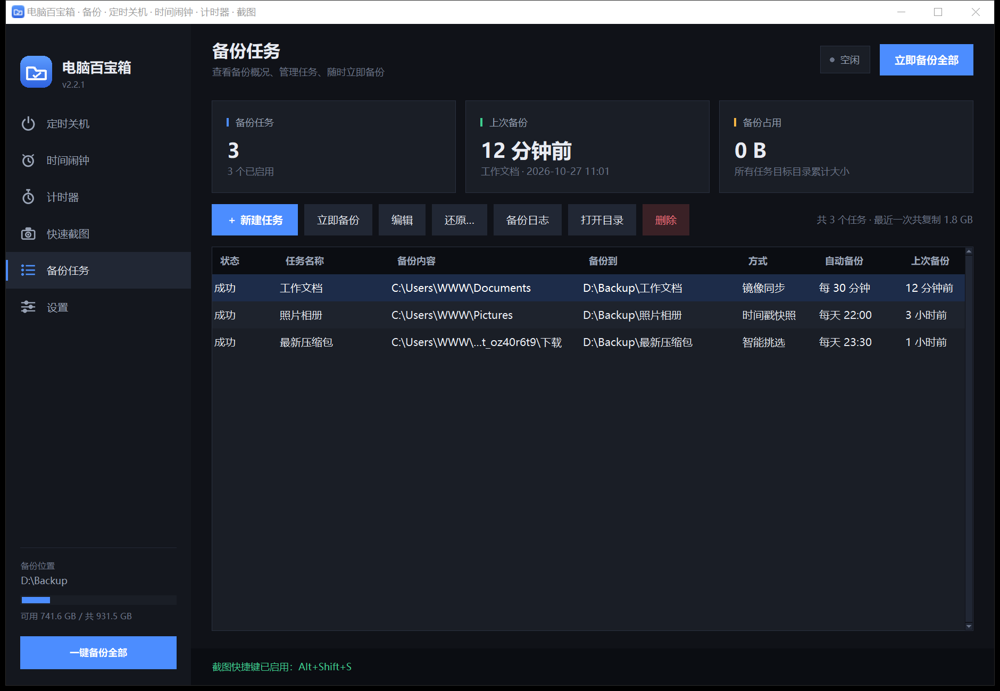

## 功能模块

顶部导航从上到下依次是：**定时关机 → 时间闹钟 → 计时器 → 快速截图 → 备份任务 → 设置**。

---

### 1. 定时关机

| 方式 | 说明 |
| --- | --- |
| 明天 08:00 关机 | 固定到次日早上 8 点 |
| 今天 08:00 关机 | 今天 8 点；如果已经过了，自动改成明天 8 点 |
| 10 小时后关机 | 从当前时间起算 10 小时 |
| 自定义延时 | 例如 2 小时 30 分钟后 |
| 自定义时刻 | 指定某天某时（如 `2026-10-25 03:00`） |

- 状态卡实时显示**倒计时**（每秒刷新）和精确的关机时间。
- **取消关机**一键中止；托盘右键菜单里也能取消。
- 关机由 Windows 自带功能执行，**退出电脑百宝箱也依然有效**；
  重启或注销会清除计划，下次需要重新设定。
- 设定前会弹出确认框，避免误操作。
- **退出软件时如果有未执行的关机计划**，会弹窗列出计划的关机时间、剩余时间和设定方式；
  确认后直接退出，**不会取消、修改或改变这条计划**。
- 如果此时还有备份任务正在进行，会提示“暂时无法退出”，需要等备份完成；这个限制与设置里的
  「退出时若正在备份，先确认」相互独立。

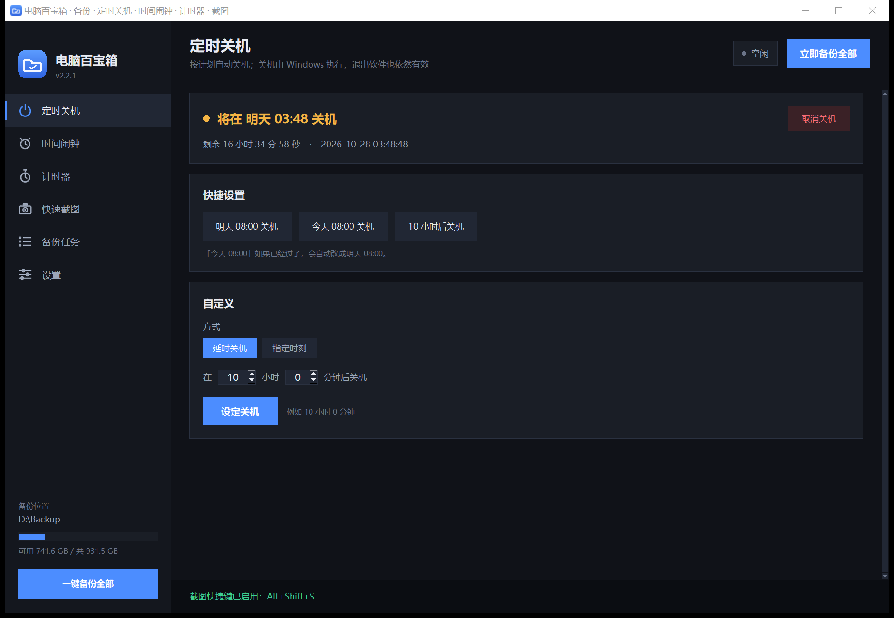

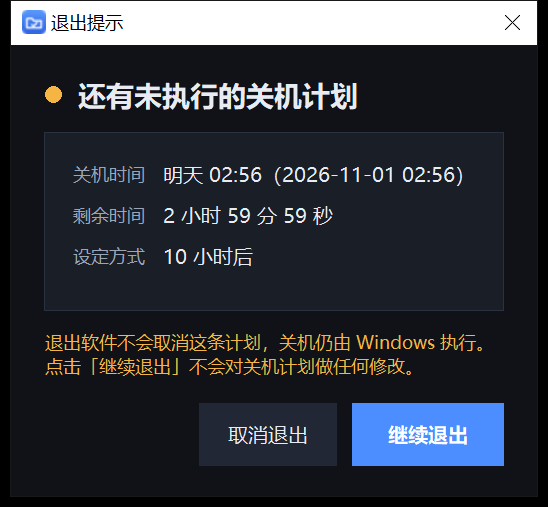

### 2. 时间闹钟（时间提醒）

- **倒计时提醒**：精确到秒（时 / 分 / 秒），到点触发。
  - 勾选 **循环提醒** 后可设「**总共提醒 N 次**」（含第一次）或「**一直重复到手动停止**」；
    每次响过之后自动重新计时，状态卡会显示 `第 2/5 次`。
- **指定时间提醒**：选日期 + 时分秒。
  - **间隔提醒**：第一次响过之后按规则继续 ——
    `不重复` / `每天同一时间` / `每个整点` / `每小时的第 X 分 Y 秒`。
  - 整点类间隔可勾选 **只在指定时间段内提醒**（如 `09:00 – 18:00`），
    窗口外自动顺延到下一次窗口起点，支持跨零点（如 `22:00 – 06:00`）；
    不勾选就是全天按间隔提醒，**直到手动取消**。
- **提醒方式由你选**（可单选可全选）：
  - 播放两声短间隔的「滴」（带「试听」按钮）
  - 弹窗确认提醒（置顶弹窗，需要点「知道了」）
- **自定义提醒文字**：弹窗里显示你自己写的内容，例如「该喝水了 / 会议 10 分钟后开始」；
  文字会被记住，下次设定以及托盘快捷方式都沿用。
- 到点后只在软件内部弹窗提示，不会再去右下角弹托盘气泡。
- 状态卡显示剩余时间 `00:12:28`；随时可取消。
- 只保留一个提醒，重新设定会覆盖旧的；关掉软件后提醒失效，
  重新打开时若时间还没到会继续计时。

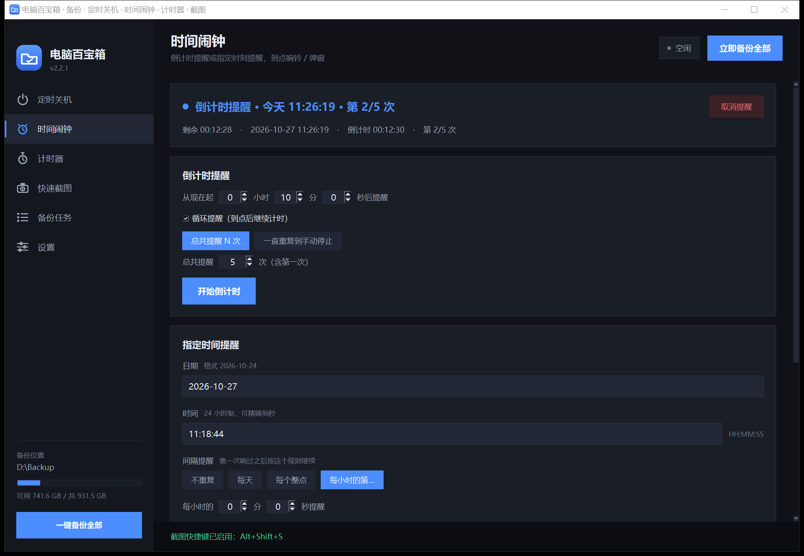

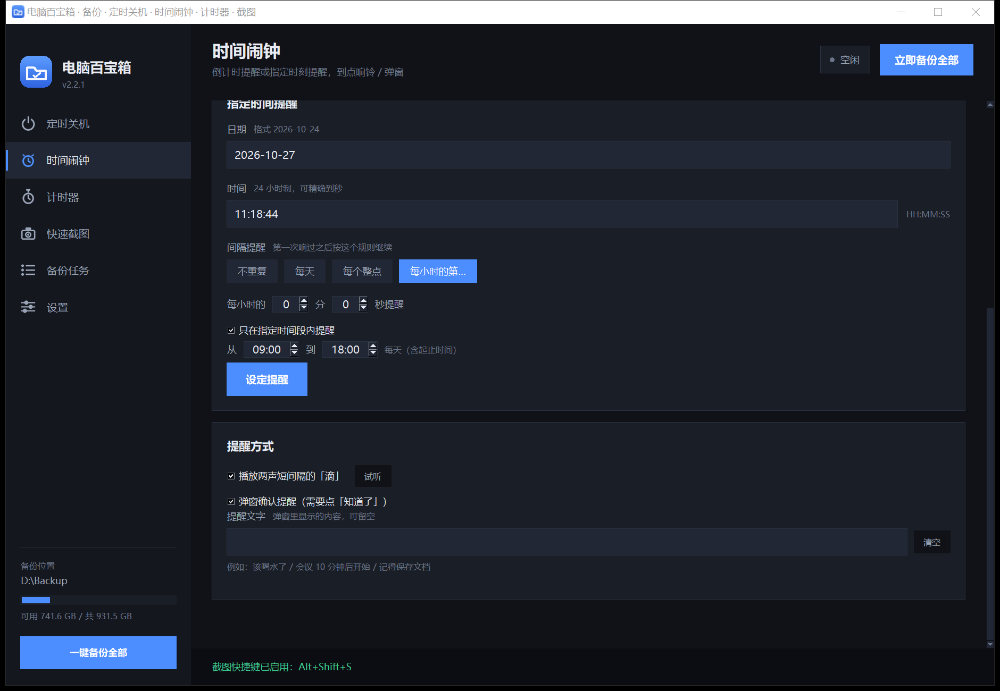

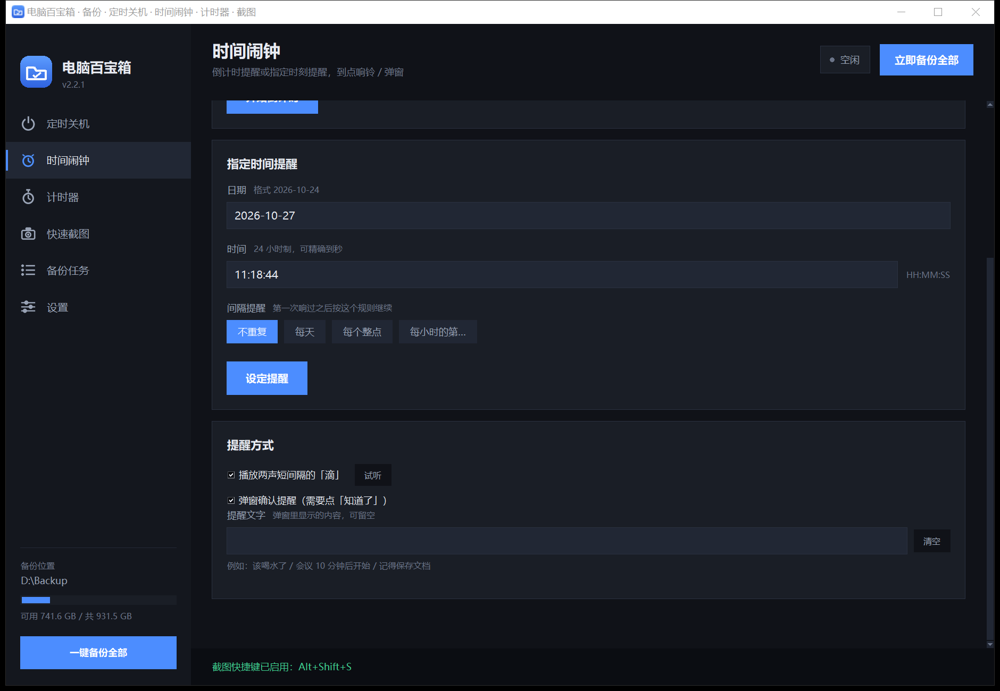

### 3. 计时器

**10 个互相独立**的计时器，一个面板同时看到全部状态。

- 面板是 **5 列 × 2 行**：第一行 1–5，第二行 6–10。
- 每个格子里只有三样东西：**序号 · 时间 · 开始/停止按钮**（不显示标题）。
- **单击序号**即可在「序号 ↔ 标题」之间切换，不带动画，点一下变一下。
- 颜色：**正计时**工作中绿色、未工作白色；**倒计时统一红色**（黑底）。
- 按钮只有两种：点 **开始** 开始计时，按钮变 **停止**；再点 **停止** 立即停止并归零。
- **正计时**：从 `00:00:00` 往上加，默认到 `99:59:59` 后立刻回到 `00:00:00` 继续；
  也可以在设置里填「计数上限」，超过上限同样立刻从头计。
- **倒计时**：未开始时格子直接显示设定时长；点开始后往下数；
  结束时（弹窗亮起那一刻）立刻回到设定的初始数字，不会停在 `00:00:00`。
- **结束提醒**：大标题用计时器名称（红色大字），背景黑/黄来回闪烁；
  第二行是你写的提醒文字（黑色小一号）；勾选「声音报警」后，
  弹窗期间会**持续「滴」**，直到点「知道了」才停。
- 10 个计时器各算各的；关掉软件再打开，配置还在，计时状态归零。
- **面板下方**是一排以标题命名的按钮，点哪个就打开哪个计时器的详细设置。

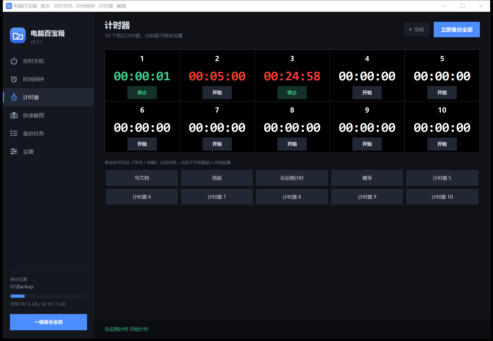

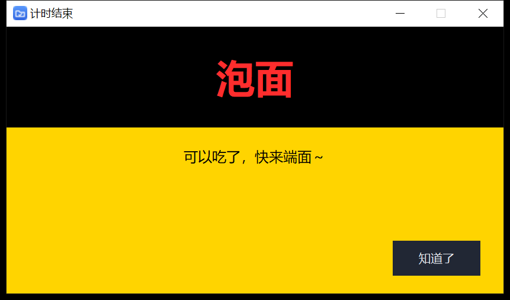

### 4. 快速截图

点页面上的「区域截图 / 全屏截图 / 窗口截图」按钮，或按对应的**全局快捷键**启动。

**快捷键规则（多热键，独立启用）：**

- **区域截图**默认 `Ctrl+Alt+A`；**全屏截图 / 窗口截图**默认不绑定，可分别自定义。
- 每个功能可单独**启用 / 禁用**；禁用状态不占用全局热键名额（上限 4 个）。
- 录制时按 `Esc` 取消、`Backspace` / `Delete` 清除；修饰键顺序不限，只有“保存”后才真正注册。
- 绑定前会校验：必须同时有修饰键和主键，`Esc`、`Backspace`、`Delete` 不能作主键，
  `Win+L` / `Win+D` / `Win+E` / `Win+R` / `Win+Tab` / `Ctrl+Alt+Del` / `Alt+Tab` /
  `Alt+F4` / `Ctrl+Shift+Esc` 等系统保留组合会被拒绝并说明原因。
- **内部冲突**（同一组合已用于另一个截图功能）会提示具体功能名，并让用户选择
  「取消」或「替换（解除对方绑定）」。
- **外部冲突**（`RegisterHotKey` 返回占用错误，如 1409）会提示
  “该快捷键可能已被系统或其他程序占用，请更换”，**不猜测占用者、不覆盖原绑定**。
- 修改时先用新 ID 注册新键，成功后再注销旧键；新键失败则旧键保持可用，不会出现“新旧都失效”。
- 启动时若默认 `Ctrl+Alt+A` 注册失败（例如 QQ / 微信已占用），会弹出**非阻塞托盘提示**，
  并在「快速截图」页和「设置」页把该项标红；**托盘菜单和页面按钮仍可截图**。
- 支持「导出 / 导入」快捷键 JSON；导入时逐条校验并注册，冲突项单独询问是否替换。

- 区域截图：屏幕会暗下来，**按住左键拖拽**框出要截的区域（红色线框），
  松开后线框保留，**双击框内确认**截图；按 `Esc` 或右键取消。
- 全屏截图使用虚拟屏幕坐标，多显示器和非 100% DPI 缩放都按物理像素抓取。
- 窗口截图截取当前前台窗口；触发时本软件窗口会先隐藏再延迟截屏，
  不会把自身界面截进去。
- 确认后自动打开**编辑窗口**，可以简单标注：
  - **矩形工具**：拖拽画出空心矩形（对角两点）。
  - **椭圆工具**：拖拽画出空心椭圆。
  - **箭头工具**：按下点是箭头尾部，松开点是实心箭头尖。
  - **颜色**：红 / 黄 / 蓝 / 绿 / 紫 / 黑 / 白 / 灰 八种，三种工具共用。
  - **粗细**：1–16，作用于矩形和椭圆的外框（箭头用同一数值决定杆粗和箭头大小）。
- **保存**：点「保存截图」或按 `Ctrl+S`，弹出保存对话框（PNG）。
  默认文件名是 `百宝箱YYYYMMDD_HHMM`（当天日期 + 当前时间，精确到分），
  用户可以确认或自行改名；**自动记住上次保存目录**，目录失效时回退到系统「图片」文件夹。
- **保存校验**：保存前检查盘符/目录是否存在、是否有写入权限；网络路径（UNC/映射盘）
  的写入放在后台线程，超时会提示并让用户重选目录。只读文件、磁盘空间不足会明确提示；
  非法字符会替换为 `_`，`CON` / `PRN` / `AUX` / `NUL` / `COM1–9` / `LPT1–9`
  等保留名会被拒绝，末尾空格/点会被清理，扩展名统一为 `.png`。
- 保存采用同目录临时文件 + 原子替换，取消或失败不会留下半成品；同一时间只允许一个保存流程，
  保存期间再次截图会被忽略。
- 画质：**开拍前先把整屏按物理像素抓下来**，确认时从这张原图裁剪，
  所以既不会把暗色遮罩拍进去，也不会有任何缩放。
- 三种标注都做了**抗锯齿**（边缘平滑），画完立刻重绘到图上，所见即所存。
- 截图抓取、PNG 编码、图形绘制全部自己实现，**不依赖任何第三方库**。

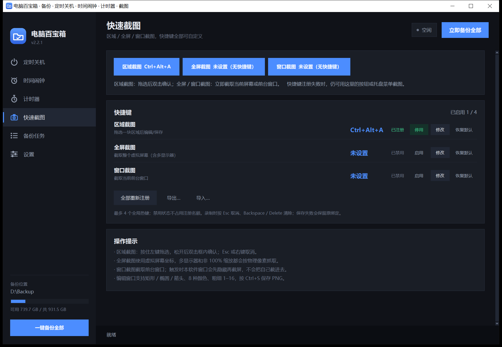

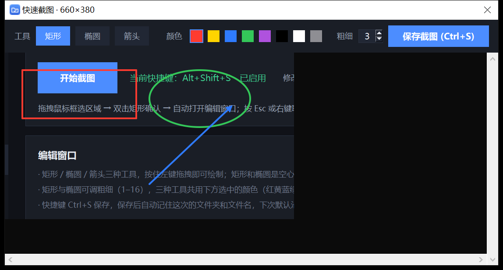

### 5. 备份任务

页面顶部是三张概况卡片（任务数 / 上次备份 / 备份占用），下面是任务列表与工具栏。

- **可以选文件夹，也可以选单个文件**：一个任务里能混着加多个文件/文件夹。
- **隐藏项**：添加来源使用自带选择器，**默认显示隐藏文件/文件夹**，可单独打开「显示系统项」；
  即使选中，备份时仍会应用任务的排除规则（如 `.git`、`$RECYCLE.BIN` 默认不会备份）。
- **备份位置自动归位**：每个任务的备份都放在
  「**主备份文件夹 \\ 任务名称 \\**」下，子文件夹自动创建。
  主备份文件夹默认是本机**最后一个固定磁盘**下的 `电脑百宝箱备份`（可在设置里改）。
- 三种备份方式：

  | 方式 | 说明 |
  | --- | --- |
  | **镜像同步** | 目标与来源保持一致，只复制新增或修改过的文件 |
  | **时间戳快照** | 每次生成 `20261023-153000` 独立文件夹，可保留 N 份历史版本 |
  | **智能挑选** | 按文件类型筛出候选（如所有 `.zip`），再按规则只备份一部分 |

- **排除规则**：按文件名或相对路径过滤（支持 `*`），默认排除 `*.tmp`、`~$*`、`.git` 等。
- **镜像清理**（可选）：删除目标中来源已不存在的文件。
- 需要时也可勾选「高级：为这个任务指定别的目标目录」。

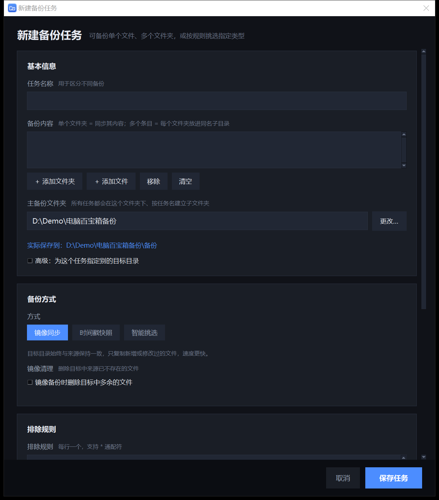

#### 智能挑选

适合「导出目录每天一个 zip，只想留最新的几个」这类场景：

- **文件类型**：`.zip, .7z, .rar`（留空 = 不限）
- **挑选规则**：最新的 N 个 / 最大的 N 个 / 全部
- **时间范围**：只看最近 N 天内改动的文件（0 = 不限）
- **包含子文件夹**、**独立时间戳目录**（可保留 N 份）

每次备份都会记录「挑中了哪些文件」，写进日志。

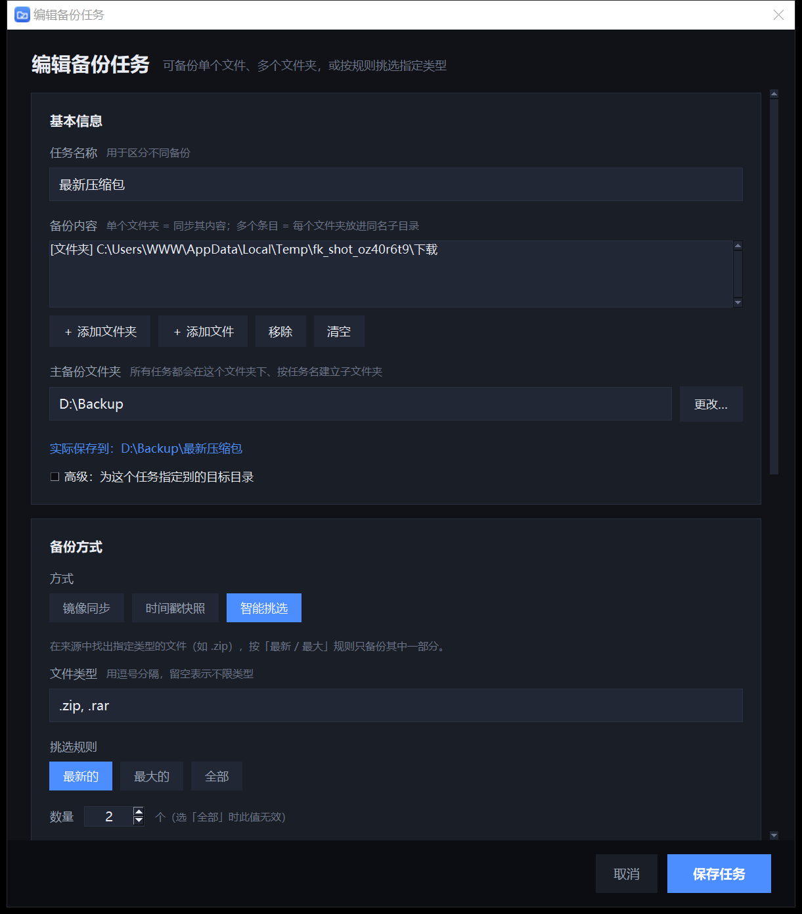

#### 自动备份

- 四种计划：**关闭** / **每隔 N 分钟** / **每天 HH:MM** / **每周几 HH:MM**
- **每天只成功备份一次**：同一天同一个计划时间点不会重复执行。
- **不再自动补跑错过的旧计划**：计划时间软件没运行、或启动时已错过，就等下一次计划。
- **新任务首次备份**：提交新任务时可选择「按设定时间自动备份」或「**5 分钟后先备份一次**」。
  后者只执行一次；如果计划是「关闭」，就只备份这一次。
- 多个任务到期时排队执行；失败任务会在 15 分钟后重试；托盘菜单里可随时**暂停 / 恢复**。

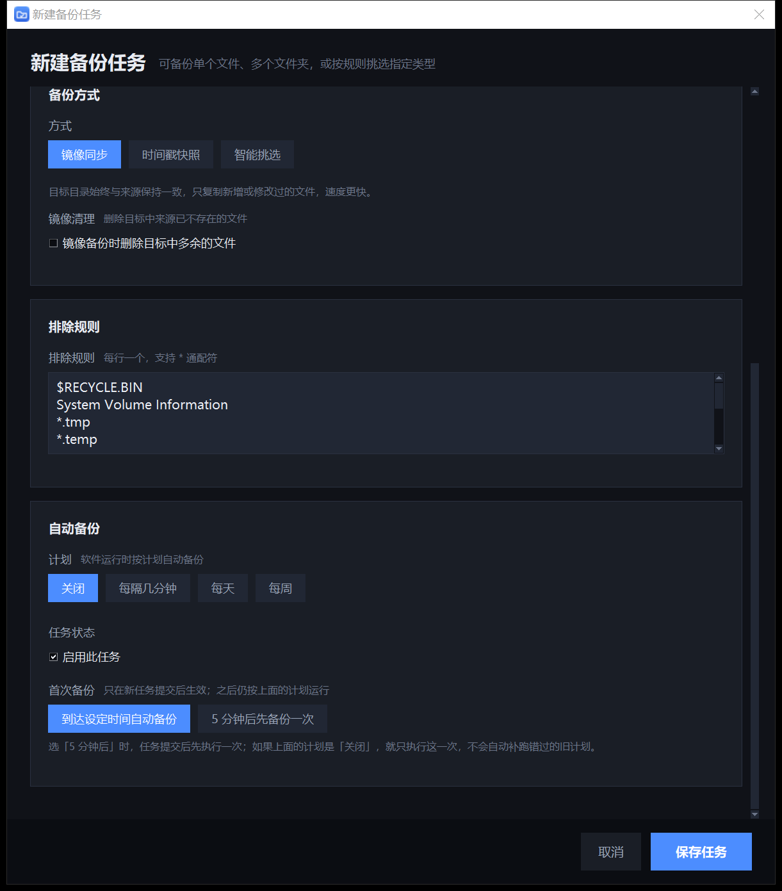

#### 手动备份与还原

- 顶栏「立即备份全部」、侧栏按钮、托盘菜单都能一键备份；单任务也有「立即备份」。
- 底部状态栏实时显示进度，可随时取消。
- 选中任务可**还原到指定文件夹**；还原前会统计文件/冲突，可选择覆盖、跳过同名或取消，
  过程中可在状态栏取消。

#### 每个任务的备份日志（txt）

每次备份结束，都会往 `主备份文件夹\<任务名>\备份日志.txt` 追加一行：

```
# 电脑百宝箱 · 备份日志
# 格式：备份时间 | 结果 | 备份的文件
# ------------------------------------------------------------
2026-10-23 22:00:31 | 成功 | 项目备份-20261022.zip、项目备份-20261021.zip
2026-10-24 22:00:07 | 成功 | （没有文件变化）
```

工具栏的**「备份日志」**按钮可直接用记事本打开。

### 6. 设置

- 主备份文件夹、默认排除规则、新任务默认值
- 新任务首次备份选项（提交时选择按计划或 5 分钟后一次）
- 开机自启、关闭到托盘、启动最小化、气泡提示
- 数据目录位置（可直接打开）

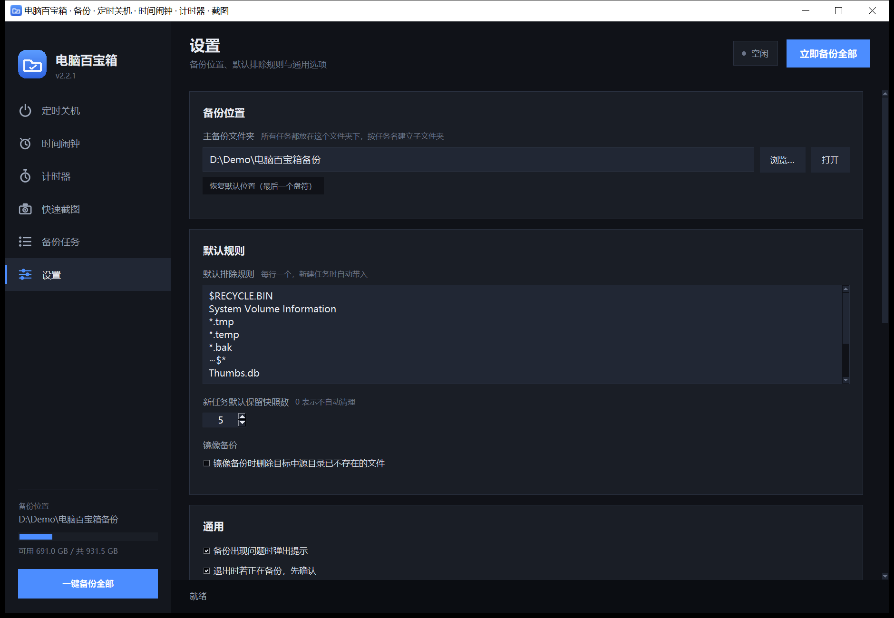

### 系统托盘与后台运行

- 关闭窗口默认**最小化到托盘**，程序继续在后台按计划备份、计时提醒、到点关机。
- **开机自动启动**：勾选后写入当前用户注册表启动项，开机直接以最小化进入托盘。
  程序目录搬家后会自动修正路径；取消勾选即移除。
- 托盘右键菜单依次是：**定时关机 ▸ / 时间闹钟 ▸ / 打开备份目录 / 退出电脑百宝箱**。
  （左键单击托盘图标可以显示/隐藏主窗口。）
- **定时关机**子菜单：明天 08:00 关机、今天 08:00 关机、10 小时后关机
  点一下**直接生效**；「自定义关机…」跳到主界面的定时关机页。
- **时间闹钟**子菜单：15 分钟后提醒、60 分钟后提醒 直接生效；
  「自定义提醒…」跳到主界面的时间闹钟页。
- 窗口隐藏时，备份结果会弹出托盘气泡（提醒本身不弹托盘气泡）。

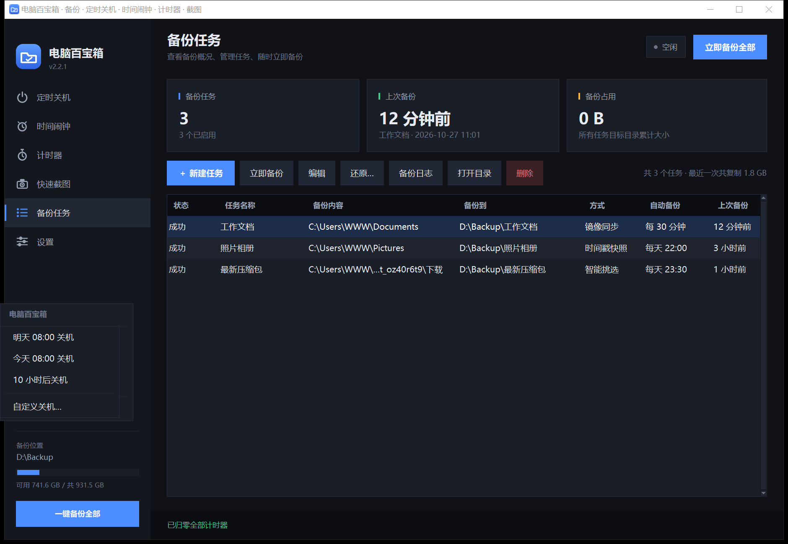

---

## 运行

> 程序是**单实例**的：重复双击只会把已经在运行（包括藏在托盘里的）窗口叫出来，
> 不会出现两个托盘图标、也不会互相抢快捷键。

### 方式一：双击 `run.bat`（推荐）
脚本会自动寻找可用 Python：项目内 `.venv` → 系统 `pythonw` → 系统 `python`
→ 本机已有的内置运行时。

### 方式二：命令行
```bat
git clone https://github.com/whj4487276/FileKeeper.git
cd FileKeeper
python main.py
```

> 界面会按系统 DPI 自动缩放（125% / 150% 高分屏同样清晰）。

---

## 数据保存在哪里（重要）

**配置随软件目录走**，不写 C 盘：

```
电脑百宝箱\
├── 电脑百宝箱.exe
├── data\               ← 配置和日志都在这里
│   ├── config.json
│   └── app.log
├── assets\
└── ...
```

把整个文件夹拷到 U 盘或另一台电脑，打开就能继续用；
**重装系统后把文件夹拷回去，所有任务和设置都还在**。

*例外*：如果程序被放在 `C:\Program Files` 这类需要管理员权限的位置，
会自动回退到 `%APPDATA%\FileKeeper\`。旧版本留在该目录的配置会在首次启动时自动迁移。

### 备份文件放在哪里

- **主备份文件夹**（设置页可改）默认是：**本机最后一个固定磁盘的根目录** 下的
  `电脑百宝箱备份`，例如 `E:\电脑百宝箱备份`。
- 每个任务的数据都在 `主备份文件夹\<任务名>\` 里，互不干扰。
- 程序启动时会自动把主备份文件夹建好（盘符不存在时静默跳过）。

---

## 打包与分发

### 1. 单文件绿色版
双击 `build_exe.bat` → `dist\电脑百宝箱.exe`（约 10 MB，免安装，双击即用）。
`data\` 会生成在 exe 旁边，整个文件夹拷走即可。

### 2. 安装包
先完成上面一步，再双击 `build_installer.bat` → `dist\电脑百宝箱安装包.exe`（约 20 MB）。

安装包会：

- 把程序复制到 `%LOCALAPPDATA%\电脑百宝箱`（可改路径，**不需要管理员权限**）；
- 在**桌面**和**开始菜单**创建快捷方式；
- 在「应用和功能」里登记卸载信息，并在安装目录放一个 `uninstall.bat`；
- 可选「安装完成后立即启动」。

> 也支持静默安装：
> `电脑百宝箱安装包.exe --dir "D:\Apps\Box" --no-shortcuts --no-launch`

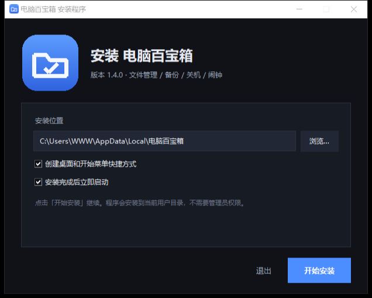

---

## 备份行为说明

1. **目标目录不能与来源相同，也不能互相包含**，保存任务时就会拦截。
2. 判断「文件是否变化」使用 **大小 + 修改时间**（2 秒容差）。
3. **布局规则**：
   - 每个任务默认备份到 `主备份文件夹\任务名称\`（自动创建）；
   - 任务内只选**一个文件夹** → 它的内容直接铺到该目录；
   - 任务内选了**多个条目** → 每个文件夹放进同名子目录，单个文件放根目录。
4. 镜像模式默认**不删除**目标中的多余文件；勾选「镜像清理」才会删。
5. 快照保留数量设为 `0` 表示不自动清理。
6. 长路径（>260 字符）自动加 `\\?\` 前缀处理。

---

## 目录结构

```
FileKeeper/
├── main.py                 启动入口（DPI 感知、异常兜底）
├── run.bat                 双击运行（源码模式）
├── build_exe.bat           打包单文件绿色版
├── build_installer.bat     打包安装包
├── installer/              安装程序源码、卸载脚本、版本信息
├── fk/
│   ├── paths.py            便携化路径（程序目录优先）
│   ├── theme.py            配色、字体、DPI 缩放、ttk 样式
│   ├── widgets.py          卡片、按钮、滚动容器等 UI 组件
│   ├── config.py           配置模型（任务/设置/历史/计划）
│   ├── backup.py           备份引擎（多来源、快照、智能挑选、还原）
│   ├── audit.py            每个任务目录下的「备份日志.txt」
│   ├── autostart.py        开机自启（HKCU Run 注册表项）
│   ├── shutdown.py         定时关机（调用 Windows shutdown.exe）
│   ├── alarm.py            时间闹钟（倒计时 / 指定时间 / 重复）
│   ├── timers.py           10 个独立计时器（正计时 / 倒计时）
│   ├── capture.py          屏幕抓取（区域 / 全屏 / 窗口）+ PNG 编码
│   ├── saveutils.py        文件名清洗、路径校验、原子写入与保存串行化
│   ├── annotate.py         截图标注光栅化（矩形 / 椭圆 / 箭头）
│   ├── hotkey.py           快捷键解析、按键映射与布局相关显示
│   ├── hotkeys.py          功能定义、合法性校验、多热键注册调度
│   ├── runner.py           后台备份队列
│   ├── scheduler.py        定时调度
│   ├── tray.py             系统托盘（纯 ctypes Win32）
│   ├── fsutil.py           文件与 Shell 工具（回收站、磁盘、长路径）
│   ├── inpututils.py       数字输入校验
│   └── ui/                 各页面 + picker.py（隐藏项来源选择器）
├── assets/                 图标资源（构建期生成）
├── tools/                  图标生成、截图工具
└── tests/                  自测脚本
```

---

## 自测

```bat
python tests\test_engine.py     :: 备份引擎 + 日志 + 自启 + 卸载器保护
python tests\test_schedule.py   :: 定时规则 / 首次备份 / 失败重试
python tests\test_config.py     :: 配置损坏降级 / 字段迁移 / 保存失败
python tests\test_runner.py     :: 备份串行执行与并发入队
python tests\test_inpututils.py :: 数字输入校验
python tests\test_shutdown.py   :: 定时关机时间计算
python tests\test_alarm.py      :: 时间闹钟时间计算
python tests\test_timers.py     :: 计时器核心逻辑
python tests\test_hotkeys.py     :: 快捷键合法性 / 冲突 / 配置迁移
python tests\test_saveutils.py   :: 截图命名 / 路径校验 / 原子写入
python tests\test_picker.py      :: 备份来源隐藏项 / 系统项选择
python tests\test_screenshot.py :: 截图抓取 / PNG / 标注 / 快捷键解析
python tests\test_single.py     :: 单实例互斥与唤起已有窗口
python tests\test_ui_smoke.py   :: 界面冒烟 + 端到端备份（窗口自动隐藏）
python tests\test_tray_menu.py  :: 托盘右键菜单逐项有效性
```

> 开发期的截图/演示配置统一把备份根目录设为 `F:\Backup`，不会在其他盘生成测试文件夹。

---

## 已知限制

- 托盘图标依赖资源管理器；Explorer 重启后会自动重新注册。
- 全局热键由 Windows `RegisterHotKey` 仲裁；被占用时无法识别占用者，也不会自动抢占或改用备用键。
- 截图保存目前仅支持 PNG；网络路径写入超过 10 秒会按超时处理并提示重选目录。
- 普通权限运行时，对以管理员权限打开的窗口，全局热键可能无效（设置页会提示，可按需提权）。
- 时间闹钟由本软件计时，需要程序保持运行（最小化到托盘可以）。
- 不监听文件系统实时变化，即时备份请用「立即备份」或把间隔设短。
- 只备份文件内容与时间戳，不保留 NTFS 权限、符号链接、备用数据流。

---

## 许可证

本项目使用 [MIT License](LICENSE)。你可以自由复制、修改、分发和商用，保留版权与许可声明即可。

如果你发现安全问题，建议先通过 GitHub 私下报告，不要直接公开利用细节；参见 [SECURITY.md](SECURITY.md)。
